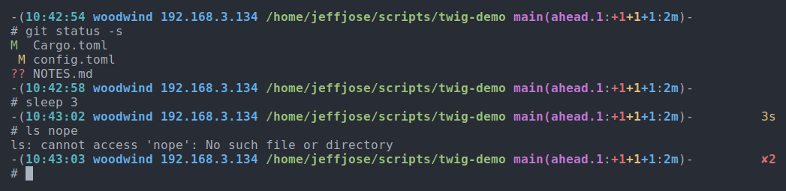
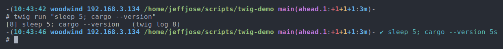

# twig

A prompt for tcsh that is fast because it does nothing slow. A daemon in
the background works out the git status, looks at the disk, the battery
and anything else you ask it to, records every command, and watches the
jobs you hand it. Each prompt is a single question to the daemon, answered
in under a millisecond.



The prompt changes while you look at it. When the git status changes
because of something done elsewhere, when a job ends, or when the disk
fills up, the daemon redraws the line above the cursor. Messages on the
prompt go away by themselves: after a while, after being seen a few
times, or when what they were about is over.



## Install

```sh
cargo install --path .
twig setup
```

`twig setup` writes `~/.config/twig/config.toml` if there is none,
brings in `~/.history`, and starts the daemon as a systemd user service.
Then add this line at the end of `~/.cshrc`:

```tcsh
if ( -X twig ) eval "`twig init tcsh`"
```

Without the service (a machine with no systemd user session), the first
prompt starts the daemon itself.

## Notices

```sh
twig notify backup done                  # for an hour
twig notify --warn --for 10m deploy is running
twig notify --error --shows 3 --here look at this    # 3 prompts, this shell only
twig ack                                 # dismiss what this shell shows
twig ack 3                               # dismiss one (ids are in twig status)
```

The daemon makes its own: a disk over 90%, a low battery, a failed
systemd unit, a restart needed for updates, a job that ended, and a
settings file with a mistake in it. Those stay while the condition does;
`twig ack` hides one until it changes.

## Jobs

```sh
twig run make test     # in the background; the prompt shows it running
twig jobs
twig log               # the newest job's output; twig log 3 -f follows job 3
twig kill 3
```

A job's output goes to a file, not to the terminal, and the job carries on
when the shell closes. When it ends, the shell that started it says so on
its prompt (✔ for a few prompts, ✘ until you read its log), and a desktop
notification comes up if it took more than 30 seconds.

## History

Every command from every shell goes into one history, with the directory
it ran in, how it ended and how long it took. A new shell's arrow keys
start with all of it, each command once.

```sh
twig h docker          # commands with "docker" in them
twig h -d              # the ones run in this directory
twig h -x              # the ones that failed
twig h -a -n 100       # every run, with when, where and how long
```

**Ctrl-R** opens a search over all of it. Type to narrow it, Tab to
switch between all commands, this directory and this shell, and Enter
puts the command on the line to edit or run.

tcsh has no way for a program to put text on the line you are editing,
so Ctrl-R is a macro: it runs `_twig_pick`, which runs the search and
loads the choice into tcsh's history, and then presses Ctrl-P. You will
see `_twig_pick` on screen for a moment.

## Directories

`z WORDS` goes to the directory you use most whose path has those words
in that order, the last one in its last part. `twig dirs` lists them.

## Settings

`~/.config/twig/config.toml`; see [config.toml](config.toml) for all of
it. Changes take effect at the next prompt. `twig info` says what is
wrong with the file and shows the prompt it makes; `twig info FILE` does
that for another file, before you put it in place.

```toml
[prompt]
format = """
-({time:cyan} {host:host} {cwd:green,bold}[ {git_branch:magenta}[ {git}]])-[ {notice}]
{symbol} """
right = "[{duration}][ {status}]"

[hosts]
"work*" = "orange"

[[probe]]
name = "vpn"
run = "ip link show tun0 >/dev/null 2>&1 && echo vpn"
every = "10s"
```

`{name}` is a variable and `{name:style}` gives it a style. Anything in
`[ ]` is left out when every variable in it is empty. A probe's first line
of output is a variable with its name, and its `notice` shows while the
command fails.

## Speed

Measured with hyperfine on an i7-12700K, with the daemon running, in a
git repository. "In tcsh" is the whole of precmd, timed by running it 200
times in a tcsh loop: tcsh's fork for the backquotes, twig asking the
daemon, the daemon drawing the prompt, and tcsh setting it.

| | per prompt |
|---|---|
| the old `~/.prompt` with `~/.aliases`, in tcsh | 19.6 ms |
| twig's precmd, in tcsh | 1.2 ms |
| `twig prompt` alone | 0.85 ms |
| `twig hook` (once per command, for history) | 0.70 ms |
| a new shell: `twig init tcsh` + loading 1,300 commands of history | 4 ms |

The daemon waits up to 80 ms (`git.wait`) for a fresh git status after a
command. A repository whose status takes longer gets its prompt at once
with the last status, and the new one is drawn when it is ready. After an
empty line nothing has run, so nothing is waited for.

`twig timings` shows where the time goes, in a box above each prompt of
that shell until you run it again:

```
╭─ prompt 2.98 ms ───────────────────────────────────────────────────╮
│ prep         0.02 ms   0%                                          │
│ connect      0.03 ms   0%                                          │
│ daemon       2.81 ms  94% █████████▍                               │
│   read       0.02 ms   0%                                          │
│   lock       0.00 ms   0%                                          │
│   state      0.04 ms   1% ▏                                        │
│   git find   0.00 ms   0%                                          │
│   git wait   2.70 ms  90% █████████                                │
│   render     0.04 ms   1% ▏                                        │
│   escape     0.00 ms   0%                                          │
│ wire         0.12 ms   4% ▍                                        │
╰─ daemon: 2.55 ms (3s ago) ─────────────────────────────────────────╯
```

The box is only what the prompt waited for. `prep` is twig gathering the
directory and environment, `wire` the socket and the scheduler, and the
steps under `daemon` its own work; `git wait` is the one step that waits
on the background, after a command, for up to `git.wait`. Not counted:
tcsh starting twig, about 0.3 ms. The bottom edge says how long the
daemon's last run of work in the background took (a probe, a git status,
a fetch) and when, for reference. No prompt waits for that.

## Status and info

`twig status` is how twig is, in one box:

```
╭─ twig  pid 2232929 · systemd · up 3h ───────────────────────────────────────────────╮
│ settings  ~/.config/twig/config.toml ✔                                              │
│ live      on                                                                        │
│ history   4,915 commands                                                            │
│ shells    2 · pts/18 ~/scripts/twig · pts/4 ~/dotfiles running make test            │
│ git       ~/scripts/twig main 3 ms, 4s ago · ~/dotfiles master 5 ms, 1m ago         │
│ notices   1 backup to basalt failed                                                 │
│ jobs      [4] make test 1m12s                                                       │
│ facts     fqdn woodwind · ip 192.168.3.134 · load 0.52                              │
│ probes    7 on time · 395 ms an hour · ip 10s · fqdn 10m · disk 30s · battery 30s   │
│           load 10s · reboot 5m · units 1m                                           │
│ prompts   0.11 ms typical · 3.02 ms slow (p95) · 9.80 ms worst · of the last 1000   │
╰─ twig info for all of it in detail ─────────────────────────────────────────────────╯
```

`twig info` is all of it in detail, from everything the daemon has seen
since it started: what is wrong with the settings; then two boxes side
by side, the prompt (what you wait for: each step over the last thousand
prompts, typical, slow and worst) and the daemon (what it does in the
background: each probe, how often, what a run takes, what that comes to
in an hour and whether the prompt shows what it finds; git status per
repository; its memory and CPU); and the prompt the settings make, with
made-up values.

```
╭─ probes, in the daemon ────────────────────────────────────────────────────────────╮
│              every   runs        avg        max  per hour   on the prompt          │
│ ip             10s    361    0.03 ms    0.20 ms     11 ms   {ip} 192.168.3.134     │
│ battery        30s    120    0.01 ms    0.14 ms      2 ms   {battery} (empty here) │
│ units           1m     60    5.09 ms    6.08 ms    305 ms   notices only           │
╰─ a prompt only reads their last value ─────────────────────────────────────────────╯
```

## When the daemon is gone or stuck

A prompt never waits on a daemon that isn't there: twig draws it itself,
with what it can find quickly (no address, no git counts), says
`twig daemon not running; starting it`, and starts one. A daemon that
doesn't answer within 400 ms costs that one prompt; then every shell
leaves it alone for 15 s, drawing its own prompts in about 2 ms with
`twig daemon not answering`. Under systemd the daemon checks in every
second and is restarted by the watchdog when it stops; one that a shell
started is killed and started again by the next shell that finds it still
not answering. A git status that fails or times out is a notice until one
succeeds. `twig restart` restarts the daemon, with systemd or without.

The service finds twig through PATH, as clutch does: a build of your own
in `~/.cargo/bin` first, then mise's, then the system's. A shell finds it
once when it starts, so prompts don't go through a mise shim (18 ms each),
and goes back to PATH if that copy is removed.

## How it works

tcsh runs `precmd` before each prompt and `postcmd` before each command.
`twig init tcsh` sets both: `postcmd` saves the command line and its
history number (from the `history` builtin, since `$_` is the previous
command at that point; an empty line runs `postcmd` too, with the number
of the line before) and tells the daemon a command is starting; `precmd`
sends the exit status, the directory and the environment, and gets back
the prompt.

The daemon redraws the line above the cursor only while the shell is in
front of its terminal (`/proc` says which process group the terminal
belongs to), at least 300 ms after it sent the prompt, and when the
terminal hasn't been resized since. If you have typed more than a line,
the redraw lands on what you typed; Ctrl-L puts it right.

| | |
|---|---|
| `~/.config/twig/config.toml` | settings |
| `~/.local/share/twig/history/HOST.jsonl` | history, one file per machine |
| `~/.local/share/twig/dirs/HOST.json` | directories for `z` |
| `~/.local/state/twig/jobs/` | jobs and their output |
| `$XDG_RUNTIME_DIR/twig/` | the socket, and the history for new shells |

History files are per machine so that copying the folder from one
machine to another merges them; `twig h -m HOST` searches one machine's.

## License

MIT
