# twig

A tcsh prompt that is fast because a daemon does the slow work in the
background. A prompt takes about 1 ms.

The prompt: time, machine, address, directory, and git.


Over ssh, the host says so.

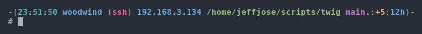

How long a slow command took.

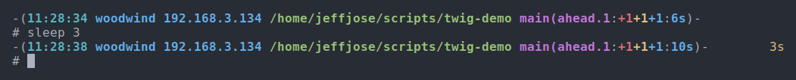

A command that failed.

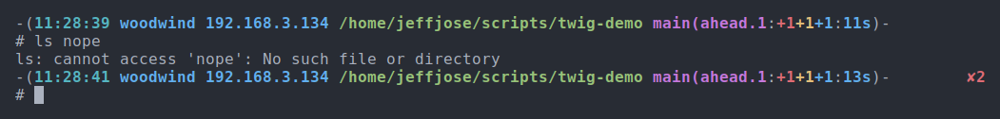

A notice, appearing while the prompt waits. No key was pressed.

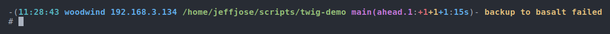

A job in the background, running.


The same job, done.

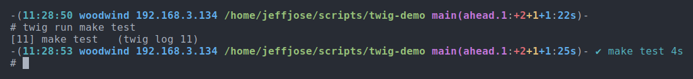

The battery, charging.

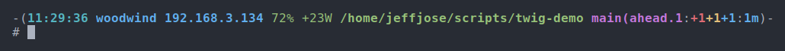

The battery, low.

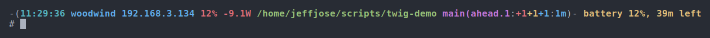

Ctrl-R: every command from every shell.

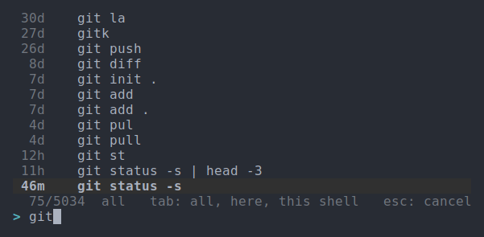

`twig timings`: what each prompt waited for.

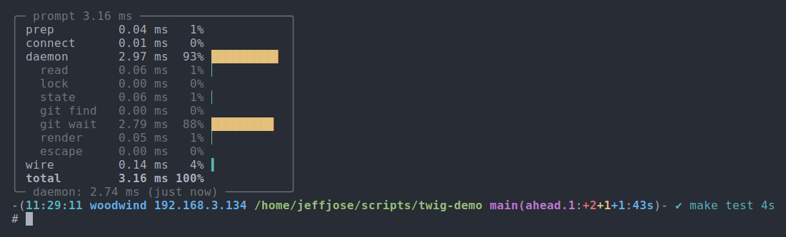

`twig status`: how twig is.

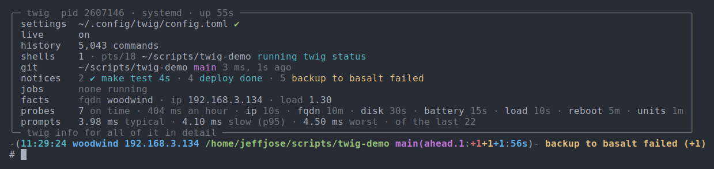

`twig notices`: the notices now, and the ones gone.

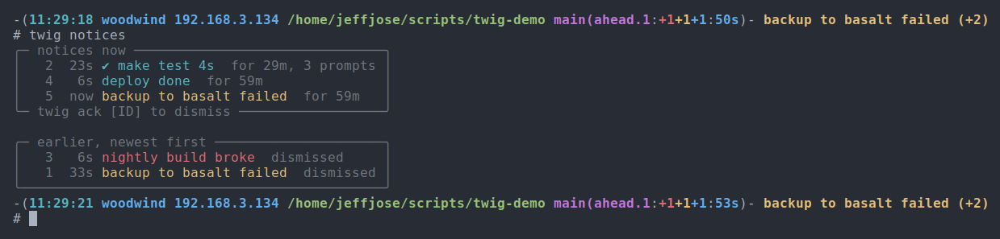

`twig info`: what each part costs.

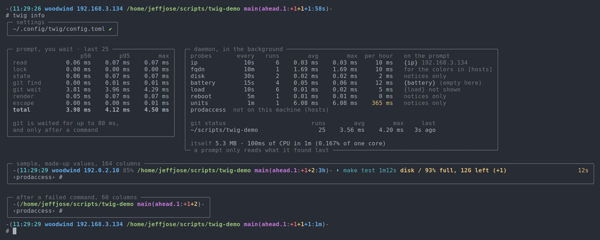

## Install

```sh
cargo install --path .
twig setup
```

Then at the end of `~/.cshrc`:

```tcsh
if ( -X twig ) eval "`twig init tcsh`"
```

## Commands

```
twig status            how it is
twig info [FILE]       what is wrong with the settings, what each part costs
twig timings           a box above each prompt; again to stop

twig notify [--warn|--error] [--for 10m] TEXT
twig notices           now, and the last 50 gone
twig notices --ignore PATTERN|ID      never show those; --unignore to undo
twig ack [ID]          dismiss

twig run COMMAND       in the background
twig jobs · twig log [ID] · twig kill [ID]

twig h [WORDS]         search the history; Ctrl-R to pick one
z WORDS                go to a directory you use

twig setup · twig restart · twig remove
```

## Settings

`~/.config/twig/config.toml`. Every setting, with what it does, is in
[config.toml](config.toml). Changes show at the next prompt.

MIT
